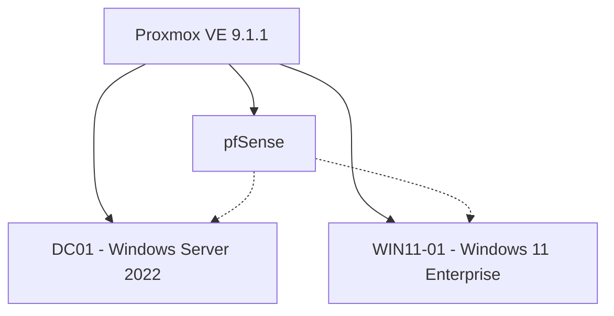

# Windows Enterprise Administration Lab

A homelab focused on developing practical skills in Windows system administration, Active Directory, PowerShell, networking, and enterprise workstation troubleshooting.

The environment is built using **Proxmox VE**, **Windows Server 2022**, **Windows 11 Enterprise**, and **pfSense**.

The project simulates a small enterprise IT environment where Windows workstations are centrally managed and common technical support issues can be reproduced, diagnosed, and resolved.

## Project Objectives

- Deploy and administer Windows Server in a virtualized environment.
- Configure Active Directory Domain Services (AD DS) and DNS.
- Join Windows 11 workstations to an Active Directory domain.
- Manage users, organizational units, security groups, and Group Policy.
- Develop PowerShell skills for system administration and troubleshooting.
- Diagnose Windows authentication, networking, service, and permission issues.
- Document real infrastructure incidents, diagnostic procedures, and resolutions.

## Lab Architecture

pfSense remains responsible for DHCP and routing, while Windows Server is configured to provide DNS services for Active Directory.

## Technologies Used

| Category                     | Technologies                     |
| ---------------------------- | -------------------------------- |
| Virtualization               | Proxmox VE 9.1.1                 |
| Server Operating System      | Windows Server 2022              |
| Workstation Operating System | Windows 11 Enterprise            |
| Identity Management          | Active Directory Domain Services |

## Virtual Machines

| Hostname | Operating System      | Purpose                                |
| -------- | --------------------- | -------------------------------------- |
| DC01     | Windows Server 2022   | Active Directory and DNS               |
| WIN11-01 | Windows 11 Enterprise | Domain workstation and troubleshooting |

### Network Configuration

| Device   | IP Address | Purpose                           |
| -------- | ---------- | --------------------------------- |
| pfSense  | 10.0.0.1   | Default gateway and DHCP          |
| DC01     | 10.0.0.100 | Static IP, intended AD DNS server |
| WIN11-01 | DHCP       | Enterprise workstation            |

**Active Directory Domain:** `corp.lab.test`

**NetBIOS Name:** `CORP`

## Documentation

Detailed technical documentation is available in the following files:

### [01 — Active Directory](docs/01-active-directory.md)

Documents the Windows Server deployment, network architecture, static IP configuration, Active Directory installation, DNS, and domain-joining procedures.

### [02 — Troubleshooting](docs/02-troubleshooting.md)

Documents infrastructure incidents, diagnostic procedures, and Windows troubleshooting exercises.

## Key Learning Outcomes

- Understanding the relationship between DHCP, DNS, and Active Directory.
- Configuring static network addressing for enterprise infrastructure.
- Deploying and administering Windows virtual machines.
- Troubleshooting virtualization and storage failures.
- Understanding thin provisioning and disk reclamation.
- Using PowerShell for Windows administration and diagnostics.
- Developing structured troubleshooting and incident documentation practices.

## Future Improvements

- Deploy additional domain-joined Windows workstations.
- Implement centralized Group Policy management.
- Create PowerShell scripts for administrative automation.
- Configure Windows file sharing and security permissions.
- Explore Windows Event Forwarding and security monitoring.
- Practice Windows Update and service troubleshooting.
- Expand Proxmox storage capacity for additional enterprise workloads.
