# Active Directory Deployment and Administration

## Overview

This document covers the deployment and configuration of a Windows enterprise environment using Windows Server 2022 and Windows 11 Enterprise.

## Infrastructure

### Virtual Machines

| Machine  | Operating System      | Role               |
| -------- | --------------------- | ------------------ |
| DC01     | Windows Server 2022   | Domain Controller  |
| WIN11-01 | Windows 11 Enterprise | Domain Workstation |
| pfSense  | pfSense               | Gateway and DHCP   |

### Network Configuration

| Setting                    | Value         |
| -------------------------- | ------------- |
| Network                    | 10.0.0.0/24   |
| Gateway                    | 10.0.0.1      |
| Domain Controller IP       | 10.0.0.100    |
| Domain Controller Hostname | DC01          |
| Target Domain              | corp.lab.test |
| NetBIOS Domain             | CORP          |
| Workstation                | WIN11-01      |

## Windows Server Deployment

Windows Server 2022 was deployed as a virtual machine within Proxmox.

### VM Configuration

| Component       | Configuration |
| --------------- | ------------- |
| Hypervisor      | Proxmox VE    |
| Firmware        | OVMF (UEFI)   |
| Machine         | q35           |
| CPU             | 4 vCPUs       |
| Memory          | 4 GiB         |
| Storage         | 40 GiB        |
| Network Adapter | VirtIO        |
| Network Bridge  | vmbr1         |
| TPM             | 2.0           |

## Configuring the Server Hostname

The Windows Server hostname was changed to `DC01`.

```powershell
Rename-Computer -NewName "DC01" -Restart
```

After restarting, the hostname was verified:

```powershell
hostname
```

Expected output:

```text
DC01
```

This establishes a recognizable server identity for the domain controller.

## Configuring Static IP

### Static IP Configuration

A domain controller should maintain a consistent network address so clients can reliably locate Active Directory DNS and authentication services.

DC01 was configured with the following settings:

| Setting         | Value         |
| --------------- | ------------- |
| IP Address      | 10.0.0.100    |
| Subnet Mask     | 255.255.255.0 |
| Default Gateway | 10.0.0.1      |
| Preferred DNS   | 10.0.0.100    |
| DHCP            | Disabled      |

The network address was configured using:

```powershell
netsh interface ipv4 set address name="Ethernet" static 10.0.0.100 255.255.255.0 10.0.0.1
```

The DNS client configuration was updated:

```powershell
Set-DnsClientServerAddress -InterfaceAlias "Ethernet" -ServerAddresses 10.0.0.100
```

Configuration was verified using:

```powershell
ipconfig /all
```

The output confirmed that DC01 had the expected hostname, static address, default gateway, and DNS configuration.

## Active Directory DNS

Active Directory depends on DNS to locate domain controllers and authentication services.

Domain members use DNS service records to locate resources.

### DNS Configuration

DC01 hosts the DNS zone for `corp.lab.test`.

Its DNS client points to `10.0.0.100` so the server can query its own Active Directory DNS service.

Public DNS requests can be forwarded to pfSense at `10.0.0.1`.

## Installing Active Directory Domain Services

The following commands document the installation and domain creation procedure.

### Check Existing Installation

```powershell
Get-WindowsFeature AD-Domain-Services
```

Check for existing services:

```powershell
Get-Service NTDS,DNS -ErrorAction SilentlyContinue
```

### Install AD DS

```powershell
Install-WindowsFeature AD-Domain-Services -IncludeManagementTools
```

This installs Active Directory Domain Services and its administrative tools.

### Create the Active Directory Forest

```powershell
Install-ADDSForest -DomainName "corp.lab.test" -DomainNetbiosName "CORP" -InstallDNS
```

This creates the Active Directory forest and configures DNS.

## Verifying Active Directory

After promotion, the domain was verified using:

```powershell
Get-ADDomain | Select-Object DNSRoot,NetBIOSName,PDCEmulator
```

The output confirmed:

```text
DNSRoot       NetBIOSName PDCEmulator
-------       ----------- -----------
corp.lab.test CORP        DC01.corp.lab.test
```

The Active Directory and DNS services were checked:

```powershell
Get-Service NTDS,DNS
```

Both services reported `Running`.

Active Directory DNS resolution was verified:

```powershell
Resolve-DnsName -Type SRV _ldap._tcp.dc._msdcs.corp.lab.test
```

The SRV record identified `dc01.corp.lab.test` on port 389 and resolved the server to `10.0.0.100`.

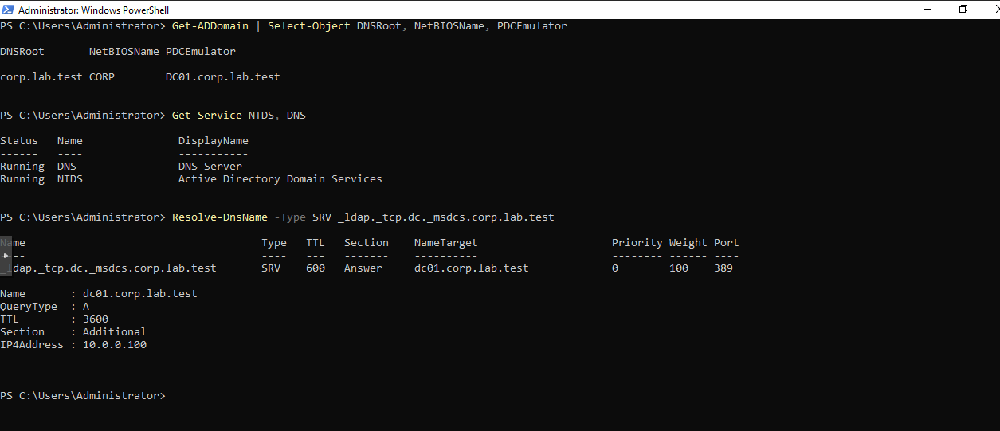

An upstream DNS forwarder can be configured if needed:

```powershell
Set-DnsServerForwarder -IPAddress 10.0.0.1
```

External DNS resolution can be tested using:

```powershell
Resolve-DnsName microsoft.com
```

## Windows 11 Enterprise Deployment

### VM Configuration

| Component        | Configuration         |
| ---------------- | --------------------- |
| Operating System | Windows 11 Enterprise |
| Firmware         | OVMF (UEFI)           |
| Machine          | q35                   |
| CPU              | 2 vCPUs               |
| Memory           | 4 GiB                 |
| Virtual Disk     | 50 GiB SATA           |
| TPM              | 2.0                   |
| Network          | vmbr1                 |
| Network Adapter  | Intel E1000           |

Windows 11 was installed using an ISO image.

The virtual machine uses a 50 GiB disk, which is below Windows 11's commonly specified 64 GB minimum storage requirement.

### VirtIO and QEMU Guest Agent

After installing Windows, VirtIO guest tools were installed.

The QEMU Guest Agent was enabled in Proxmox:

```bash
qm set 113 --agent enabled=1
```

Communication was tested from the Proxmox host:

```bash
qm guest cmd 113 ping
```

## Joining Windows 11 to Active Directory

WIN11-01 was configured to use DC01 as its DNS server before joining the `corp.lab.test` domain.

### Configure DNS

On WIN11-01:

```powershell
Set-DnsClientServerAddress -InterfaceAlias "Ethernet" -ServerAddresses 10.0.0.100
```

The workstation's network configuration was verified using:

```powershell
ipconfig /all
```

| Setting         | Value         |
| --------------- | ------------- |
| IPv4 Address    | 10.0.0.18     |
| Subnet Mask     | 255.255.255.0 |
| Default Gateway | 10.0.0.1      |
| DNS Server      | 10.0.0.100    |
| DHCP            | Enabled       |

### Join the Domain

The following command was used to join WIN11-01 to Active Directory:

```powershell
Add-Computer -DomainName "corp.lab.test" -Credential (Get-Credential) -Restart
```

Domain administrator credentials were supplied to authorize the operation.

After restarting, domain membership was verified:

```powershell
Get-CimInstance Win32_ComputerSystem | Select-Object Name,Domain,PartOfDomain
```

Output:

```text
Name       Domain          PartOfDomain
----       ------          ------------
WIN11-01   corp.lab.test   True
```

The domain administrator account was also verified:

```powershell
whoami
```

Output:

```text
corp\administrator
```

## Verifying Domain Connectivity

After joining the domain, additional checks were performed to verify communication between WIN11-01 and DC01.

### Secure Channel Verification

The initial PowerShell secure-channel test returned `False`:

```powershell
Test-ComputerSecureChannel
```

Further investigation was performed using:

```powershell
nltest /sc_verify:corp.lab.test
```

Results:

```text
Trusted DC Connection Status Status = 0 0x0 NERR_Success
Trust Verification Status = 0 0x0 NERR_Success
```

A subsequent verbose PowerShell verification succeeded:

```powershell
Test-ComputerSecureChannel -Verbose
```

Output:

```text
True
VERBOSE: The secure channel between the local computer and the domain corp.lab.test is in good condition.
```

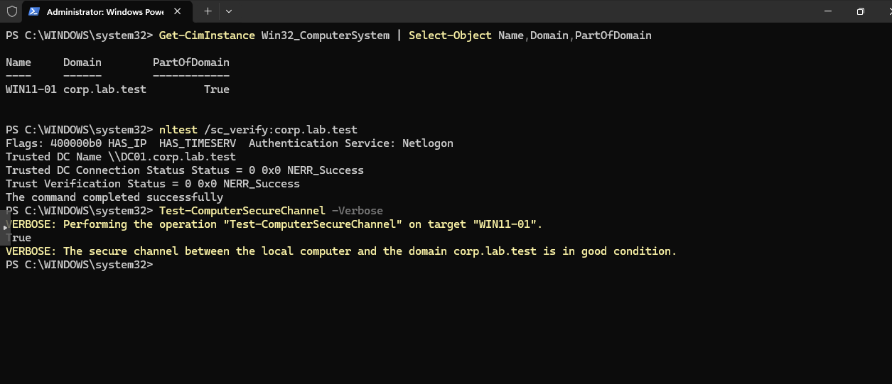

### Network Connectivity

SMB connectivity to the domain controller was tested:

```powershell
Test-NetConnection 10.0.0.100 -Port 445
```

Result:

```text
TcpTestSucceeded : True
```

### Time Synchronization

```powershell
w32tm /query /status
```

The workstation reported:

```text
Source: DC01.corp.lab.test
Leap Indicator: 0 (no warning)
```

This confirmed that WIN11-01 was synchronizing time with the domain controller.

## Active Directory User Administration

### Creating an Organizational Unit

Active Directory Users and Computers was opened on DC01:

```powershell
dsa.msc
```

An organizational unit named `Employees` was created under the `corp.lab.test` domain.

### Creating an Employee Account

A test employee account was created within the Employees OU.

| Attribute           | Value                |
| ------------------- | -------------------- |
| First Name          | John                 |
| Last Name           | Smith                |
| Username            | jsmith               |
| User Principal Name | jsmith@corp.lab.test |
| Domain Logon        | CORP\jsmith          |
| Organizational Unit | Employees            |

### Verifying Employee Authentication

WIN11-01 was accessed using the employee account.

PowerShell was used to verify the authenticated identity:

```powershell
whoami
```

Output:

```text
corp\jsmith
```

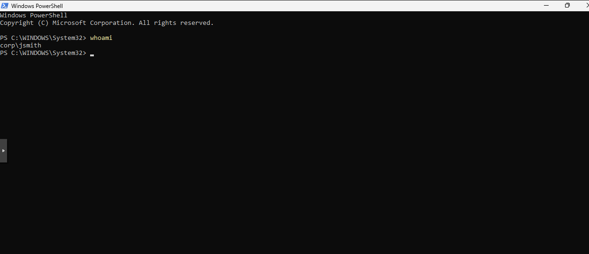

This confirmed that the employee account could successfully authenticate and sign in to the domain-joined Windows 11 workstation.

---

## Exercise 01 — Employee Password Reset

### Scenario

An employee reported that they had forgotten their Windows password and could no longer access their workstation.

The objective was to reset the employee's password centrally through Active Directory.

### Investigation

On DC01, the employee account was inspected using PowerShell:

```powershell
Get-ADUser jsmith -Properties Enabled,LockedOut,PasswordExpired,PasswordLastSet
```

The account was confirmed to be enabled and not locked out.

### Resolution

Active Directory Users and Computers was opened on DC01.

The employee account was located under:

```text
corp.lab.test
└── Employees
    └── John Smith
```

The **Reset Password** action was used to assign a new password.

### Verification

The account status was checked again:

```powershell
Get-ADUser jsmith -Properties Enabled,LockedOut,PasswordExpired,PasswordLastSet |
    Select-Object Name,Enabled,LockedOut,PasswordExpired,PasswordLastSet
```

The resulting account properties showed:

```text
Name            : John Smith
Enabled         : True
LockedOut       : False
PasswordExpired : False
PasswordLastSet : 10/28/2026 2:23:07 PM
```

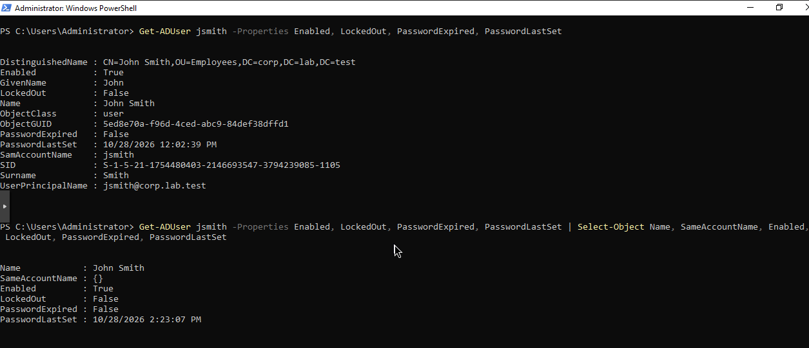

### Outcome

The password reset was completed successfully, and Active Directory reflected the updated password timestamp.

---

## Exercise 02 — Active Directory Account Lockout

### Scenario

An employee repeatedly entered an incorrect password while attempting to sign in to WIN11-01.

The objective was to reproduce an account lockout, identify the affected account, and restore access using Active Directory.

### Configuring the Account Lockout Policy

Group Policy Management was opened on DC01:

```powershell
gpmc.msc
```

The account lockout policy was configured under:

```text
Default Domain Policy
└── Computer Configuration
    └── Policies
        └── Windows Settings
            └── Security Settings
                └── Account Policies
                    └── Account Lockout
```

The following settings were applied:

| Policy                              | Configuration            |
| ----------------------------------- | ------------------------ |
| Account lockout threshold           | 3 invalid logon attempts |
| Account lockout duration            | 30 minutes               |
| Reset account lockout counter after | 30 minutes               |
| Allow Administrator account lockout | Enabled                  |

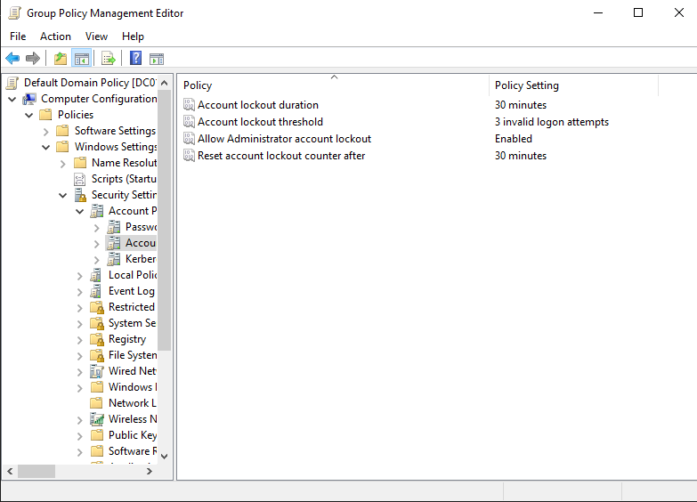

### Reproducing the Lockout

Multiple incorrect password attempts were made using the `CORP\jsmith` account on WIN11-01.

Windows subsequently displayed:

```text
The referenced account is currently locked out and may not be logged on to.
```


This confirmed that the configured account lockout behavior was functioning.

### Investigating the Account

On DC01, Active Directory Users and Computers was used to inspect the employee account.

The Account tab indicated:

```text
Unlock account. This account is currently locked out on this Active Directory Domain Controller.
```

The account could also be inspected through PowerShell:

```powershell
Get-ADUser jsmith -Properties LockedOut,BadPwdCount,LastBadPasswordAttempt |
    Select-Object Name,LockedOut,BadPwdCount,LastBadPasswordAttempt
```

### Investigating the Security Event

Windows Event Viewer was opened on DC01:

```powershell
eventvwr.msc
```

The Security log was inspected for Event ID `4740`, which records account lockout events.

An event associated with the employee account was identified.

| Event Attribute         | Value                 |
| ----------------------- | --------------------- |
| Event ID                | 4740                  |
| Target Account          | jsmith                |
| Originating Workstation | WIN11-01              |
| Domain                  | CORP                  |
| Timestamp               | 10/28/2026 5:22:09 PM |

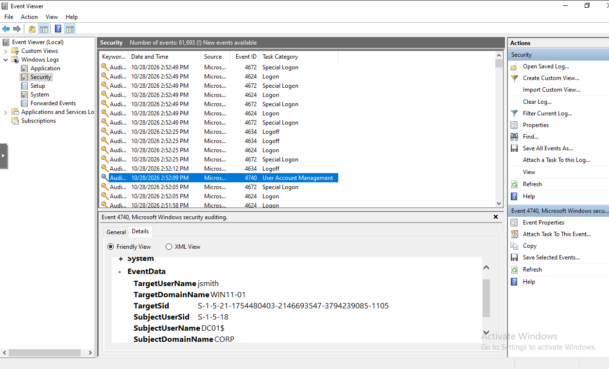

The event provided evidence of the lockout and identified the workstation associated with the failed authentication attempts.

### Resolution

The employee account was unlocked through Active Directory Users and Computers.

On the Account tab, the following option was selected:

```text
Unlock account.
```

The change was then applied.

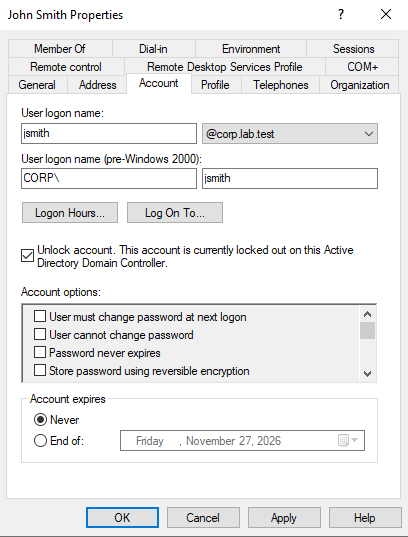

The equivalent PowerShell command for unlocking the account is:

```powershell
Unlock-ADAccount -Identity jsmith
```

### Verification

After unlocking the account, the employee successfully signed in to WIN11-01 using the correct password.

### Outcome

The account lockout was successfully reproduced, investigated, and resolved.

---

## Exercise 03 — Employee Account Deactivation and Reactivation

### Scenario

An employee was leaving the organization, and IT received a request to deactivate their Active Directory account.

The objective was to disable the account, verify that new domain authentication was blocked, inspect the associated Windows Security event, and restore access following a simulated reactivation request.

### Disabling the Employee Account

On DC01, Active Directory Users and Computers was used to locate John Smith under the `Employees` organizational unit.

The **Disable Account** action was selected.

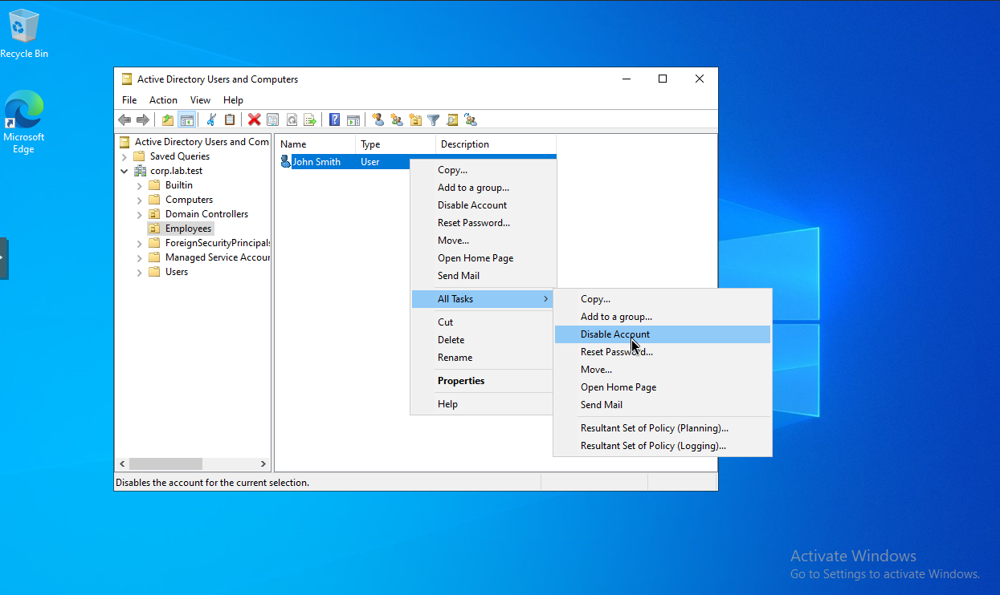

The account status was verified using PowerShell:

```powershell
Get-ADUser jsmith
```

Output:

```text
Name    : John Smith
Enabled : False
```

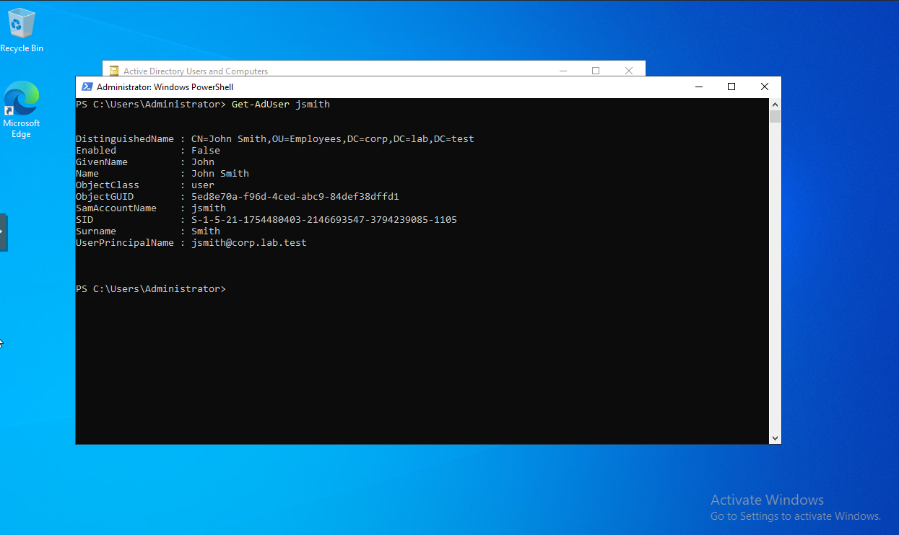

This confirmed that the Active Directory account had been disabled.

### Verifying Authentication Restrictions

Initially, WIN11-01 still had an active Windows session under `CORP\jsmith` despite the account being disabled.

This required distinguishing between an existing Windows session, cached credentials, and fresh domain authentication.

After a subsequent sign-in test, Windows displayed:

```text
Your account has been disabled. Please see your system administrator.
```

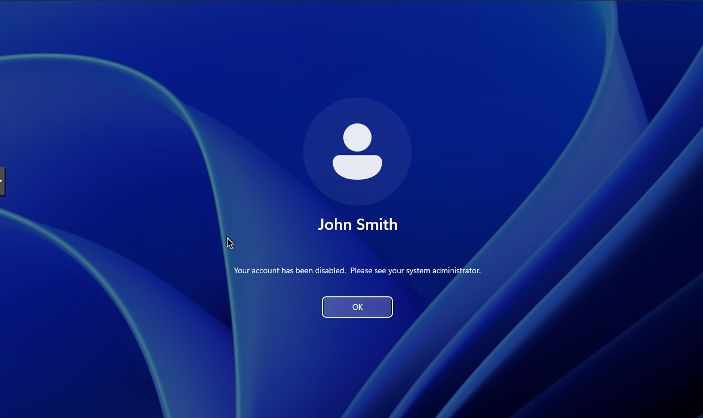

This demonstrated that the disabled account was prevented from establishing a new authenticated Windows session during the test.

### Investigating the Security Event

Windows Event Viewer was opened on DC01:

```powershell
eventvwr.msc
```

The Security log was inspected for Event ID `4725`, which records when an Active Directory user account is disabled.

The following event was identified:

| Event Attribute   | Value                       |
| ----------------- | --------------------------- |
| Event ID          | 4725                        |
| Event Description | A user account was disabled |
| Target Account    | jsmith                      |
| Domain            | CORP                        |
| Administrator     | CORP\Administrator          |
| Domain Controller | DC01.corp.lab.test          |
| Timestamp         | 10/28/2026 4:15:50 PM       |

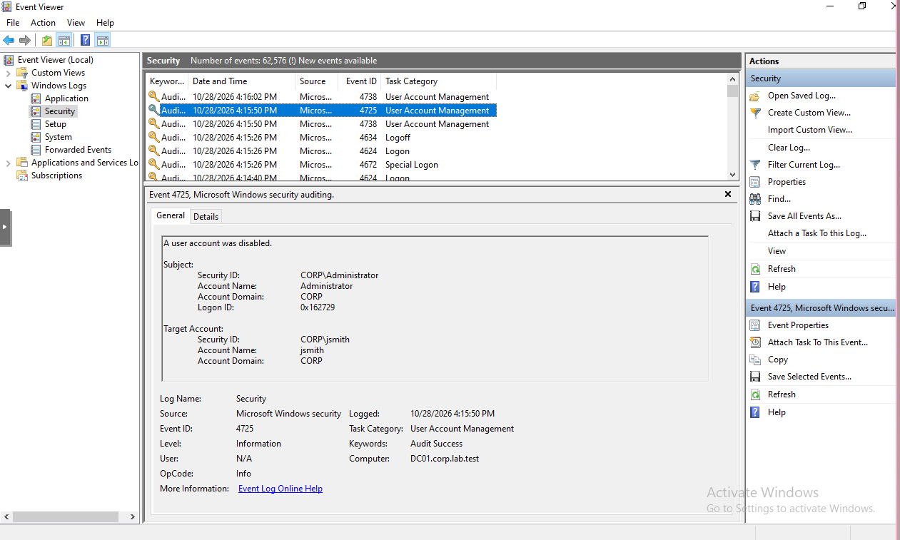

The event established an audit trail identifying the affected account and the administrator who performed the deactivation.

### Reactivating the Employee Account

Following a simulated request to restore access, John Smith's account was re-enabled through Active Directory Users and Computers.

The **Enable Account** action was selected.

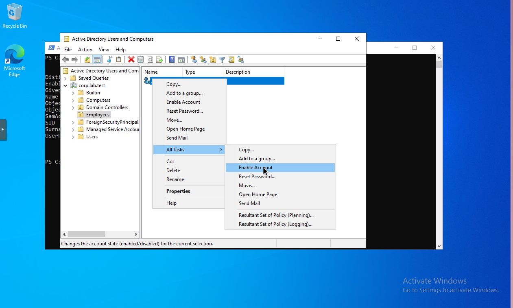

The equivalent PowerShell command is:

```powershell
Enable-ADAccount -Identity jsmith
```

### Verifying Account Reactivation

The account status was inspected again on DC01:

```powershell
Get-ADUser jsmith
```

Output:

```text
Name    : John Smith
Enabled : True
```

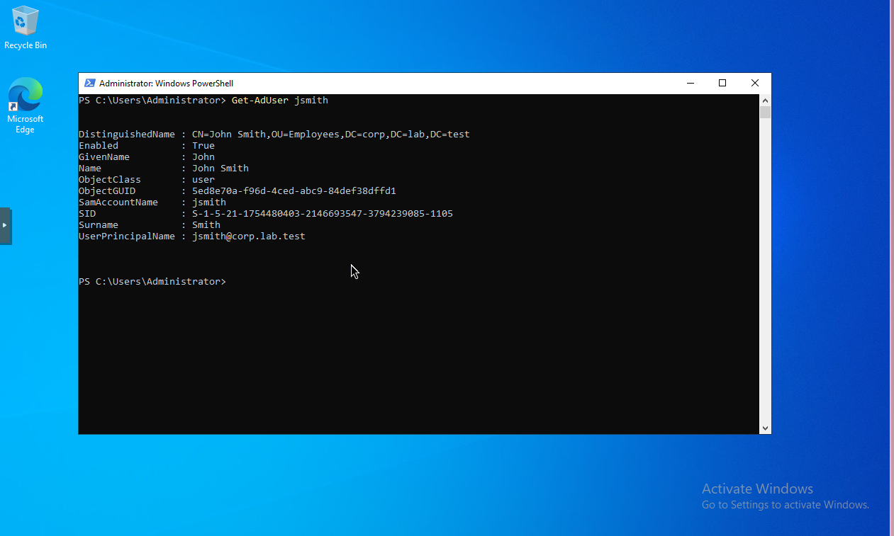

The Windows Security log was also checked for Event ID `4722`, which records when a user account is enabled.

The following event was identified:

| Event Attribute   | Value                      |
| ----------------- | -------------------------- |
| Event ID          | 4722                       |
| Event Description | A user account was enabled |
| Target Account    | jsmith                     |
| Domain            | CORP                       |
| Administrator     | CORP\Administrator         |
| Domain Controller | DC01.corp.lab.test         |
| Timestamp         | 10/28/2026 4:24:21 PM      |

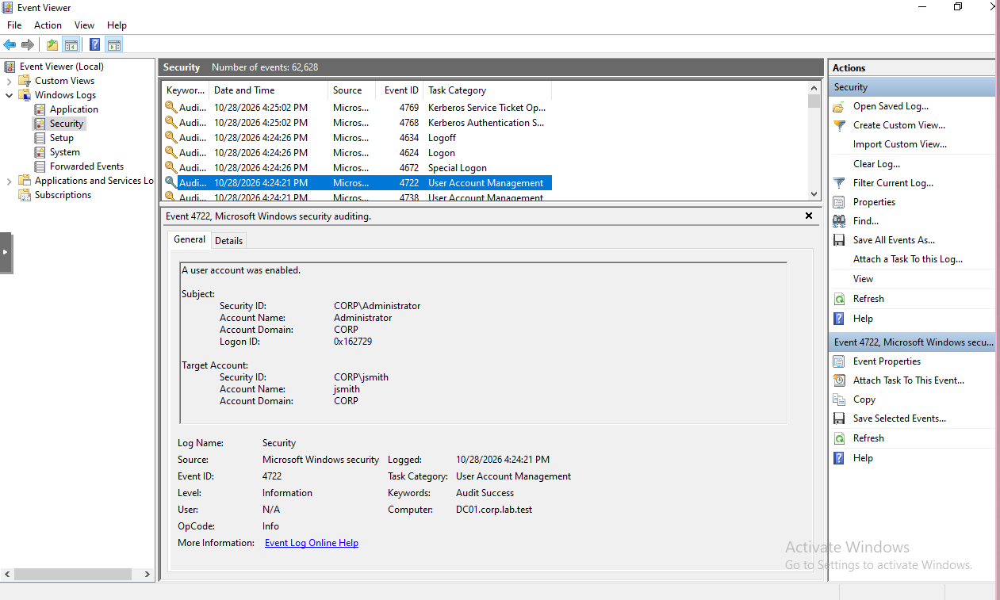

These results confirmed that the employee account was successfully re-enabled and that the administrative action was recorded in the Security log.

### Outcome

The account deactivation and reactivation procedures were completed successfully.
